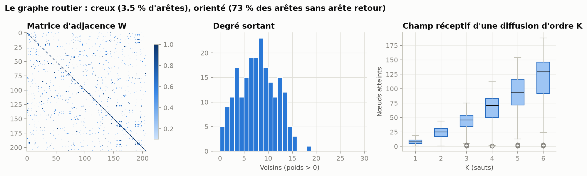

## De la marche aléatoire à la convolution

Une matrice de transition $P = D_O^{-1}W$ (lignes stochastiques) décrit une marche
aléatoire sur le graphe : $P_{ij}$ est la probabilité d'aller de $i$ vers $j$ en un pas.
Appliquer $P^k$ à un signal $X$ revient à **moyenner chaque nœud sur les nœuds
atteignables en $k$ pas**, pondérés par la probabilité de la marche.

Une convolution par diffusion **apprend un mélange** de ces moyennes :

$$
H = \sum_{k=0}^{K} \Big( P_f^{\,k} X\,\Theta_{k,f} + P_b^{\,k} X\,\Theta_{k,b} \Big)
\quad\text{avec}\quad P_f = D_O^{-1}W,\;\; P_b = D_I^{-1}W^\top
$$

- $k = 0$ : le nœud lui-même (terme « auto ») ;
- $k = 1$ : ses voisins directs ;
- $k = 2$ : voisins de voisins, etc.

{#fig-diffusion}

## Dans le code

L'implémentation tient en quelques lignes (`src/stforecast/models/gwnet.py`) :

```python
def nconv(x, a):
    # x : (B, C, N, T) ; a : (N, N)  →  Σ_v x[..., v, :] · a[v, w]
    return torch.einsum("ncvl,vw->ncwl", x, a)

class DiffusionGCN(nn.Module):
    def forward(self, x, supports):
        out = [x]                       # k = 0
        for a in supports:              # P_f, P_b, (Ã adaptative)
            x1 = nconv(x, a); out.append(x1)          # k = 1
            for _ in range(2, self.order + 1):
                x1 = nconv(x1, a); out.append(x1)     # k = 2..K
        return self.mlp(torch.cat(out, dim=1))        # Θ : conv 1×1
```

## Champ réceptif

Avec $K = 2$ (Graph WaveNet) et 8 couches empilées, l'information peut voyager jusqu'à
16 sauts. En pratique, l'essentiel du signal vient des 1-2 premiers sauts.

{#fig-reach}

## Adjacence adaptative

Graph WaveNet ajoute un support **appris** :

$$
\tilde{A} = \mathrm{softmax}\big(\mathrm{ReLU}(E_1 E_2^\top)\big), \qquad E_1, E_2 \in \mathbb{R}^{N \times 10}
$$

Ce sont deux embeddings de nœuds de dimension 10, initialisés au hasard. **C'est
conceptuellement très proche de l'identité spatiale de STID** : dans les deux cas, on
apprend un vecteur par nœud. La différence est son usage. Dans Graph WaveNet, il sert à
*router l'information entre nœuds* ; dans STID, il *conditionne la prédiction du nœud*.
Nous comparons la matrice apprise à la matrice routière sur la page
[Ablations](../experience/ablations.qmd).
