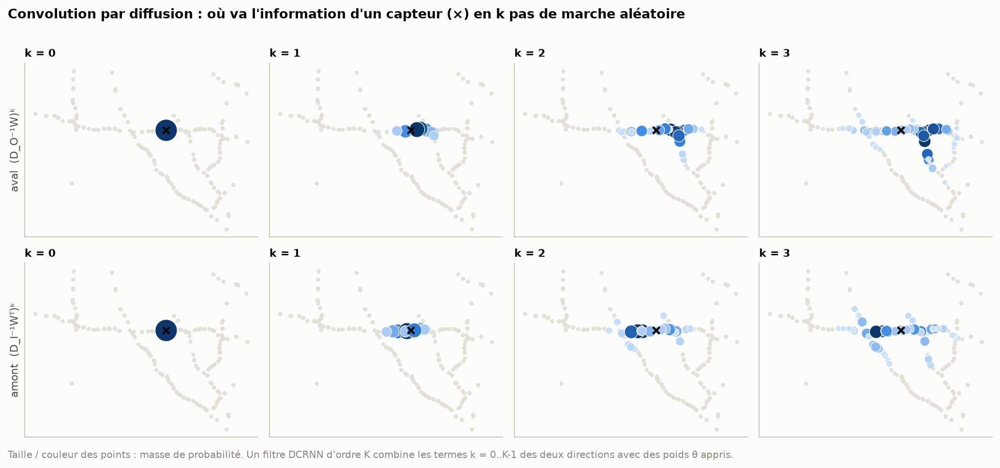

## De la marche aléatoire à la convolution

Une matrice de transition $P = D_O^{-1}W$ (lignes stochastiques) décrit une marche
aléatoire sur le graphe : $P_{ij}$ est la probabilité d'aller de $i$ vers $j$ en un pas.
Appliquer $P^k$ à un signal $X$ revient à **moyenner chaque nœud sur les nœuds
atteignables en $k$ pas**, pondérés par la probabilité de la marche.

Une convolution par diffusion **apprend un mélange** de ces moyennes :

$$
H = \sum_{k=0}^{K} \Big( P_f^{\,k} X\,\Theta_{k,f} + P_b^{\,k} X\,\Theta_{k,b} \Big)
\quad\text{avec}\quad P_f = D_O^{-1}W,\;\; P_b = D_I^{-1}W^\top
$$

- $k = 0$ : le nœud lui-même (terme « auto ») ;
- $k = 1$ : ses voisins directs ;
- $k = 2$ : voisins de voisins, etc.

{#fig-diffusion}
