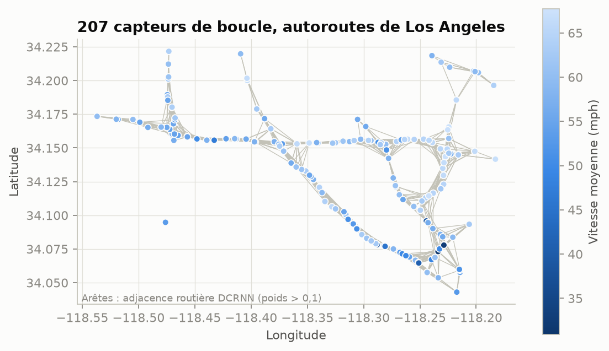
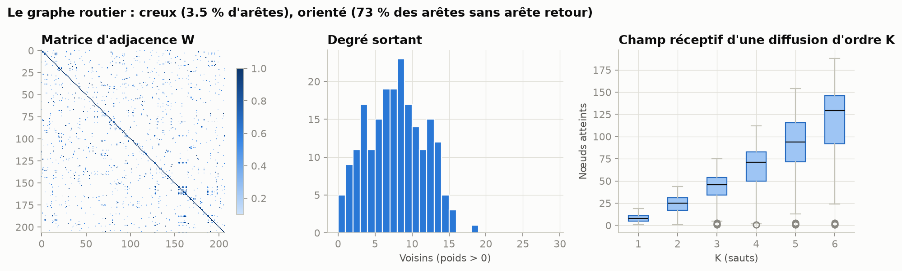
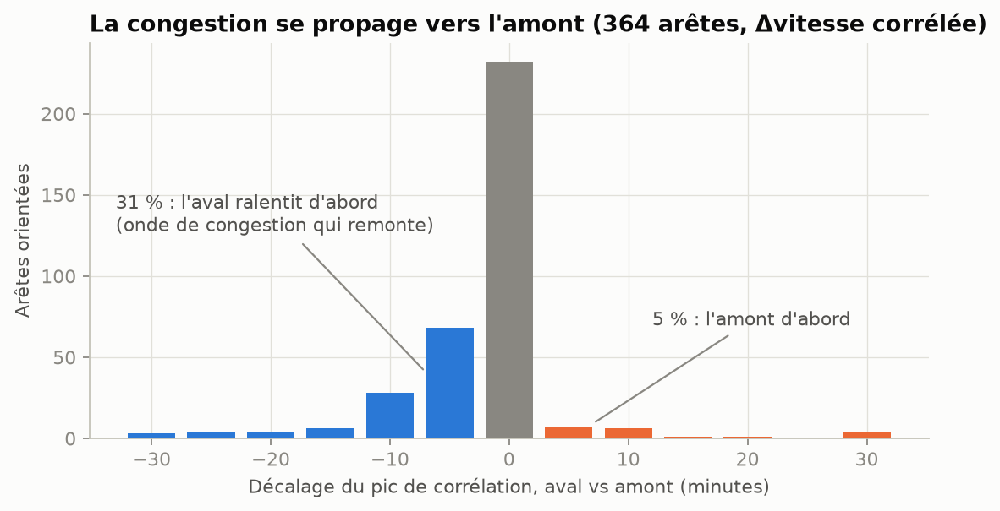

::: {.lead-question}
Un STGNN suppose que *l'état des voisins aide à prévoir l'état d'un nœud*. Encore faut-il
définir « voisin », puis vérifier que l'hypothèse rapporte plus qu'elle ne coûte.
:::

## Quatre façons de fabriquer un graphe

| Source | Construction | Forces | Faiblesses |
|---|---|---|---|
| **Géographique** | distance euclidienne entre capteurs | trivial, disponible partout | deux voies parallèles en sens opposé sont « voisines » à tort |
| **Réseau routier** (METR-LA) | distance *sur la route*, noyau gaussien seuillé, **orienté** | encode le sens de circulation | demande un graphe routier propre ; figé |
| **Corrélation** | similarité des séries historiques | capture des liens non géographiques | dérivé des données : fuite possible si mal splitté |
| **Appris** (adaptatif) | $\tilde{A} = \mathrm{softmax}(\mathrm{ReLU}(E_1 E_2))$ entraîné de bout en bout | aucun a priori, s'adapte | opaque ; transductif ; peut apprendre du bruit |

: Les sources d'adjacence. Graph WaveNet combine les deux dernières lignes « route » et « appris ». {tbl-colwidths="[15,30,27,28]"}

## Le graphe de METR-LA

{#fig-map}

{#fig-adj}

## Le graphe porte-t-il du signal ? Un test simple avant tout modèle

Un critère nécessaire, mais pas suffisant : sur une arête orientée amont→aval, les
variations de vitesse des deux capteurs doivent être **corrélées avec un décalage**.
Sinon, l'information du voisin arrive en même temps que celle du nœud lui-même, et le
graphe n'apporte rien qu'une identité de nœud ne sache déjà.

{#fig-prop}

Lecture :

- **64 %** des arêtes ont leur pic à **0** : à 5 minutes de résolution, l'information est
  simultanée. Le voisin n'apporte pas d'avance.
- **31 %** ont un pic **négatif** : l'aval ralentit *avant* l'amont. C'est l'**onde de choc
  de congestion qui remonte le flux**, le phénomène que la diffusion *amont* de DCRNN capture.
- Seulement 5 % montrent une propagation « dans le sens du flux ».

::: {.callout-important}
## Conséquence pour la suite
Le graphe contient bien un signal d'**anticipation** exploitable sur environ un tiers des
arêtes. C'est assez pour que le STGNN puisse gagner, surtout aux horizons longs où
l'onde a le temps d'arriver. Ce n'est pas assez pour garantir que le gain dépasse ce
qu'un bon embedding de nœud capture déjà. **Seule l'ablation tranche** :
[résultats](../experience/resultats.qmd).
:::

## Comment valider un graphe (protocole)

```{mermaid}
flowchart TD
  A["Baseline non-graphe fort<br/>(STID)"] --> C{"Le STGNN bat STID<br/>au-delà du bruit ?"}
  B["STGNN complet"] --> C
  C -- non --> D["Déployer STID<br/>(garder le STGNN en veille)"]
  C -- oui --> E{"Le gain vient-il du graphe ?<br/>STGNN vs STGNN sans graphe"}
  E -- non --> F["Le gain vient de l'architecture temporelle<br/>→ l'injecter dans le baseline"]
  E -- oui --> G{"Quelle source ?<br/>route / adaptatif / les deux"}
  G --> H["Gain / coût (latence, compute,<br/>maintenance du graphe) acceptable ?"]
  H -- oui --> I["Déployer le STGNN"]
  H -- non --> D
```

C'est exactement le plan d'expérience de ce projet (voir [Protocole](../experience/protocole.qmd)).
