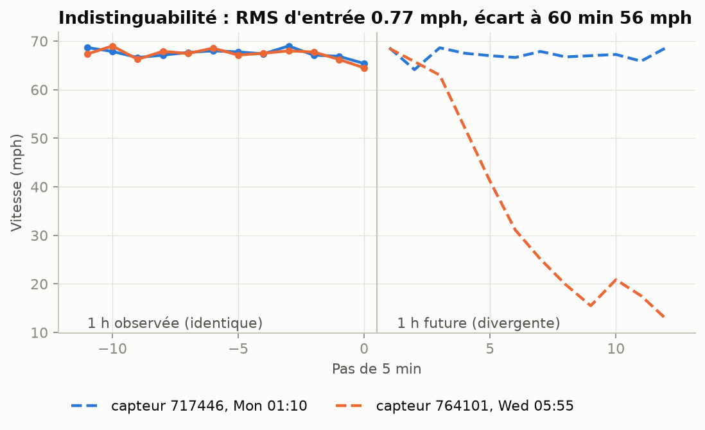
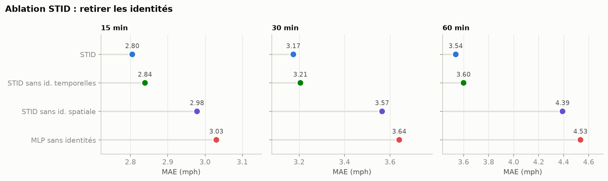
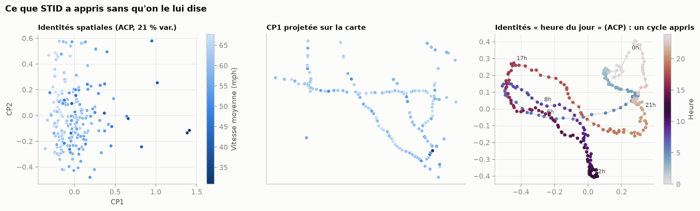

::: {.lead-question}
Un modèle qui ne voit que la dernière heure de vitesses d'un capteur peut-il savoir **de
quel capteur** et **de quel moment** il s'agit ? Non. Et c'est le goulot d'étranglement.
:::

## Le problème en une figure

{#fig-twins}

Pour un modèle qui ne reçoit que ces 12 valeurs, les deux échantillons sont
**indistinguables**. Il est donc contraint de prédire *la même chose* pour les deux, en
pratique une moyenne des deux futurs, fausse dans les deux cas.

Ces jumeaux ne sont pas rares. Dans le [notebook d'exploration](../experience/exploration.ipynb),
sur 6 000 fenêtres tirées au hasard, on compte environ 36 000 paires dont les entrées
diffèrent de moins de 1 mph RMS. **5,4 % d'entre elles divergent de plus de 10 mph à
60 minutes.** Ce sont les débuts de congestion, c'est-à-dire précisément les cas qui
comptent pour le dispatch.

## Deux façons de lever l'ambiguïté

```{mermaid}
flowchart LR
  Q["Fenêtre ambiguë<br/>(même entrée, futurs ≠)"] --> G["STGNN : regarder les voisins<br/>« l'aval ralentit déjà »"]
  Q --> I["STID : dire qui et quand<br/>« capteur 764101, mercredi 5 h 55 »"]
  G --> R["Futur désambiguïsé"]
  I --> R
```

- Le **graphe** désambiguïse par le *contexte spatial courant*. Si les voisins en aval
  ralentissent, la congestion arrive.
- L'**identité** désambiguïse par la *mémoire statistique*. Ce capteur, à cette heure, ce
  jour-là, bouchonne habituellement.

La seconde est bien moins chère : une table de correspondance plutôt qu'un passage de
messages sur le graphe à chaque couche.

## Ce que l'ablation dit sur METR-LA



{#fig-abl}

Lecture :

1. **L'identité spatiale est décisive.** Sans elle, la MAE à 60 min passe de 3,54 à
   **4,39** (+24 %). C'est la même hiérarchie que l'article STID sur PEMS04.
2. **L'écart grandit avec l'horizon** : +6 % à 15 min, +24 % à 60 min. À court terme, la
   fenêtre récente suffit. À long terme, il faut savoir « qui » l'on prévoit.
3. **Les identités temporelles apportent peu ici** (3,54 → 3,60). Ce n'est **pas** parce
   que l'heure est inutile, mais parce que, comme dans BasicTS, l'entrée contient déjà
   l'heure et le jour en **canaux bruts** (`input_dim = 3`). L'information temporelle
   reste donc accessible. Les embeddings la rendent seulement plus facile à exploiter.
4. Un MLP **sans aucune identité** fait *moins bien* à 60 min que la simple moyenne
   historique (4,53 contre 4,19). Sans savoir « qui » ni « quand », un réseau de neurones
   perd face à une table de moyennes qui, elle, est indexée par capteur et par créneau.

## Ce que STID a appris

{#fig-emb}

- **Identités spatiales.** La première composante est fortement corrélée à la vitesse
  moyenne du capteur (corrélation de −0,73). Les capteurs chroniquement congestionnés
  forment une queue distincte. Sur la carte, ils se regroupent sur les mêmes tronçons.
  L'embedding a donc appris une **géographie fonctionnelle** sans jamais voir le graphe.
- **Identités « heure du jour ».** La projection trace une **boucle fermée**
  (0 h → 6 h → 8 h → 12 h → 17 h → 21 h → 0 h), avec des inflexions aux pointes. Le
  modèle a redécouvert la périodicité du trafic.

## Limite : un nœud nouveau n'a pas d'identité

L'embedding d'un capteur n'existe que s'il a été vu à l'entraînement. Pour un **nouveau
hub logistique**, STID n'a rien à proposer sans réentraînement. Un STGNN peut, lui,
s'appuyer sur la topologie routière. C'est le principal argument *structurel* en
faveur du graphe, indépendamment de la précision. Voir le [System design](../system-design.qmd).
