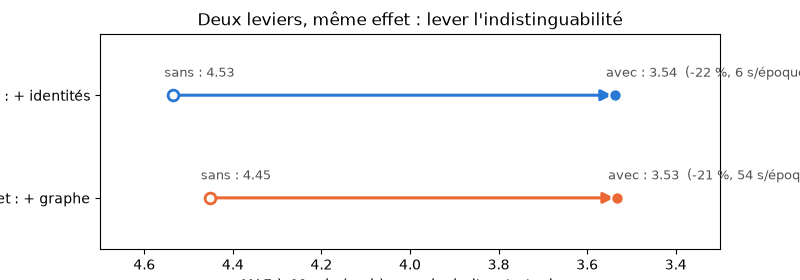
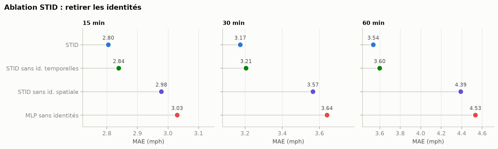
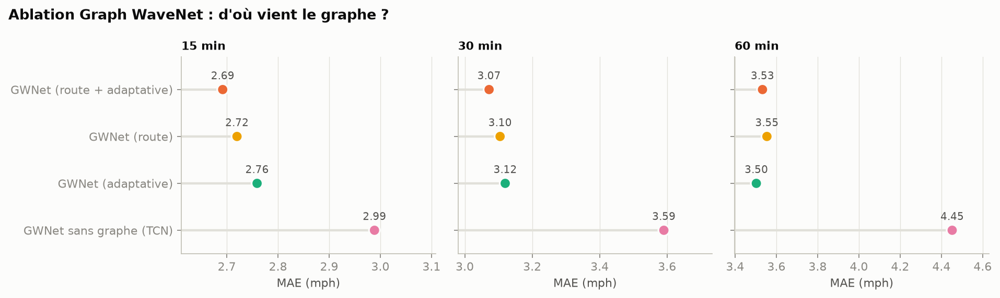

::: {.callout-note}
## Le résultat en une phrase
**Le graphe de Graph WaveNet et les identités de STID font le même travail.** Retirer l'un
ou l'autre coûte environ 22 % de MAE à 60 min. Mais les identités coûtent 9 fois moins de
calcul.
:::

## Deux leviers, même effet

{#fig-subst}

| | Sans le levier | Avec | Gain | s / époque |
|---|---|---|---|---|
| STID : identités espace + temps | 4,53 | 3,54 | −22 % | 5,8 |
| Graph WaveNet : graphe (route + adaptative) | 4,45 | 3,53 | −21 % | 53,8 |

: MAE à 60 min. Les deux modèles « nus » (MLP, TCN) sont aussi mauvais l'un que l'autre, et
les deux modèles « complets » aussi bons l'un que l'autre. {#tbl-subst}

C'est la démonstration expérimentale de la thèse de STID. Un modèle spatio-temporel doit
d'abord **savoir distinguer les échantillons** : quel capteur, à quel moment. Le graphe y
parvient *indirectement*, en injectant le contexte des voisins qui situe le nœud dans le
réseau. L'identité y parvient *directement*, avec un vecteur appris par nœud.

## Ablation STID



{#fig-abl-stid}

L'identité **spatiale** porte l'essentiel du gain. Détails et interprétation des embeddings
sur [L'indistinguabilité des échantillons](../concepts/indistinguabilite.qmd).

## Ablation Graph WaveNet : d'où vient le graphe ?



{#fig-abl-gw}

1. **Le graphe est indispensable à Graph WaveNet.** Sans lui, le TCN pur s'effondre à 4,45
   (+26 % à 60 min) et s'arrête tôt (meilleure époque 64). Son architecture ne contient
   aucun autre moyen de distinguer les nœuds.
2. **Route ou appris, peu importe à 60 min.** Route seule 3,55, adaptative seule 3,50,
   les deux 3,53. Les écarts entre variantes sont inférieurs à ce qu'une graine de plus
   pourrait déplacer.
3. **À court terme, la route aide.** À 15 min, route (2,72) < adaptative (2,76), et la
   combinaison est la meilleure (2,69). La topologie réelle transporte l'information
   *immédiate* des voisins.
4. **À long terme, l'adaptative suffit.** Elle fait même légèrement mieux à 60 min. Une
   matrice apprise sans aucun a priori égale la carte routière.
