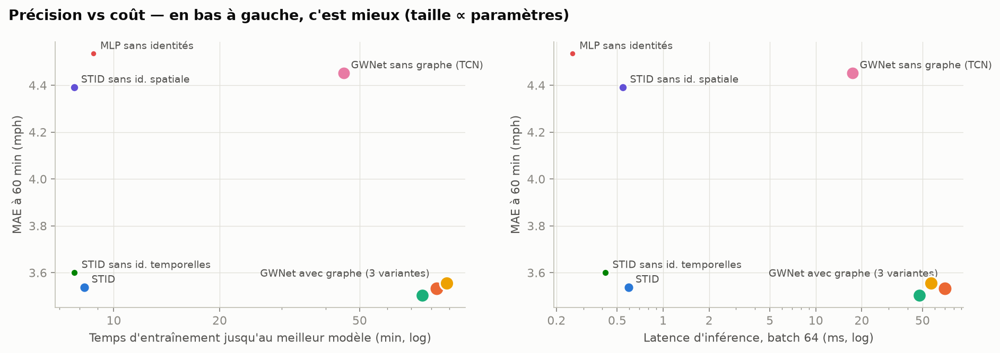
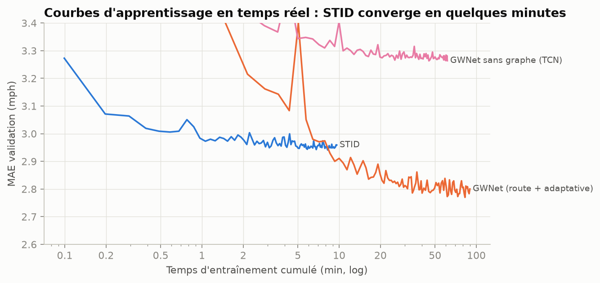

::: {.kpi-row}
::: {.kpi}
[× 9]{.v}
[temps par époque, GWNet vs STID]{.l}
:::
::: {.kpi}
[× 10]{.v}
[temps jusqu'au meilleur modèle]{.l}
:::
::: {.kpi}
[× 11 / × 119]{.v}
[latence d'inférence, batch 1 / batch 64]{.l}
:::
::: {.kpi}
[× 30]{.v}
[mémoire GPU de pointe]{.l}
:::
:::

## Tableau des coûts



## Précision contre coût

{#fig-pareto}

{#fig-lc}

## Lecture

- **Entraînement.** STID atteint son meilleur modèle en **8 minutes**, GWNet en **83 minutes**.
  Sur un réentraînement hebdomadaire, c'est négligeable dans les deux cas. Ça ne l'est plus
  pour une recherche d'hyperparamètres ou un réentraînement par région sur des milliers de nœuds.
- **Inférence.** À 2 ms par requête unitaire, GWNet reste compatible avec un service temps
  réel. Mais l'écart de **× 119 en batch** signifie qu'un scoring de tout le réseau toutes
  les 5 minutes coûte deux ordres de grandeur de plus en GPU.
- **Mise à l'échelle.** L'adjacence adaptative est **dense** ($N \times N$). Sur 207 nœuds, ça
  ne se voit pas. Sur 5 000 nœuds, la matrice pèse 25 millions de coefficients par
  couche de diffusion, et le coût devient quadratique. STID reste linéaire en $N$.
- **Convergence.** GWNet atteint sa meilleure validation à l'époque 94 sur 100. Un budget
  plus long l'améliorerait peut-être légèrement, ce qui **accentuerait** encore l'écart de
  coût (voir les [notes d'implémentation](https://github.com/gwils28/spatio-temporal-forecasting/blob/main/docs/notes/implementation.md)).

::: {.callout-note}
## Précaution de mesure
Deux entraînements partageaient le GPU (RTX 5070 Laptop). Les temps absolus sont
pessimistes, mais les deux familles ont subi la même contention : les **ratios** sont
interprétables. Les chiffres de l'article STID (PEMS-BAY, RTX 2080Ti : 15,8 s contre
112 s par époque, × 7) vont dans le même sens.
:::
