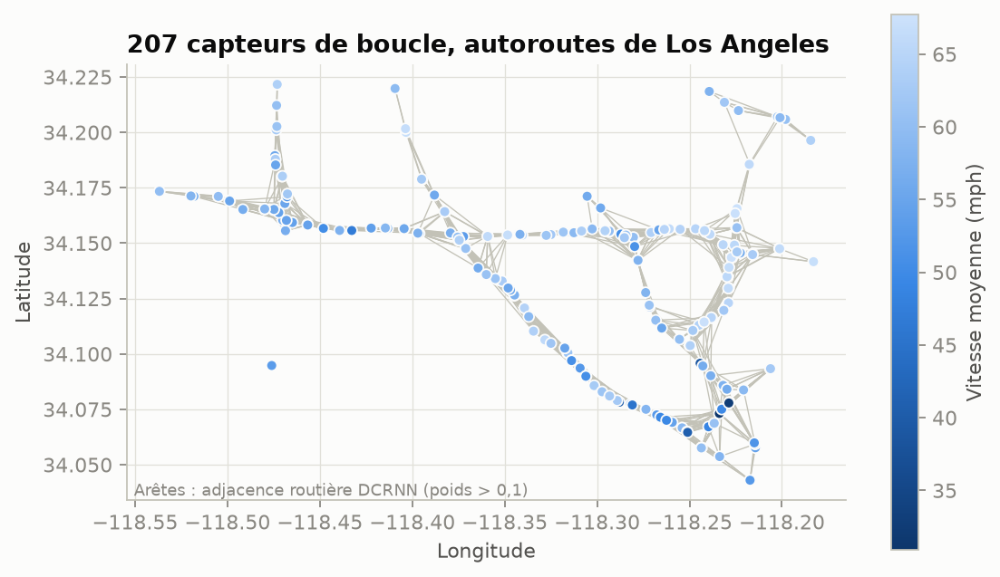
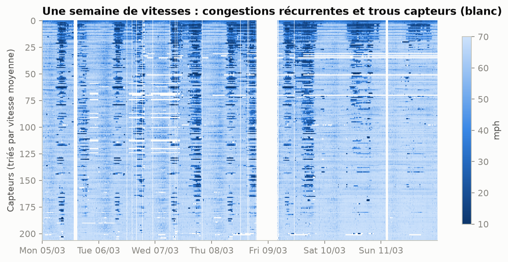
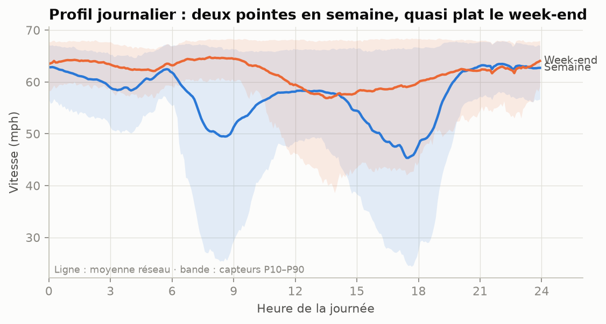
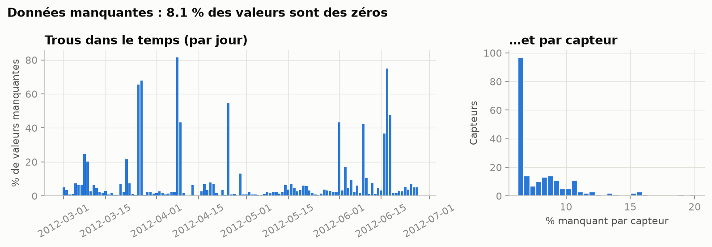
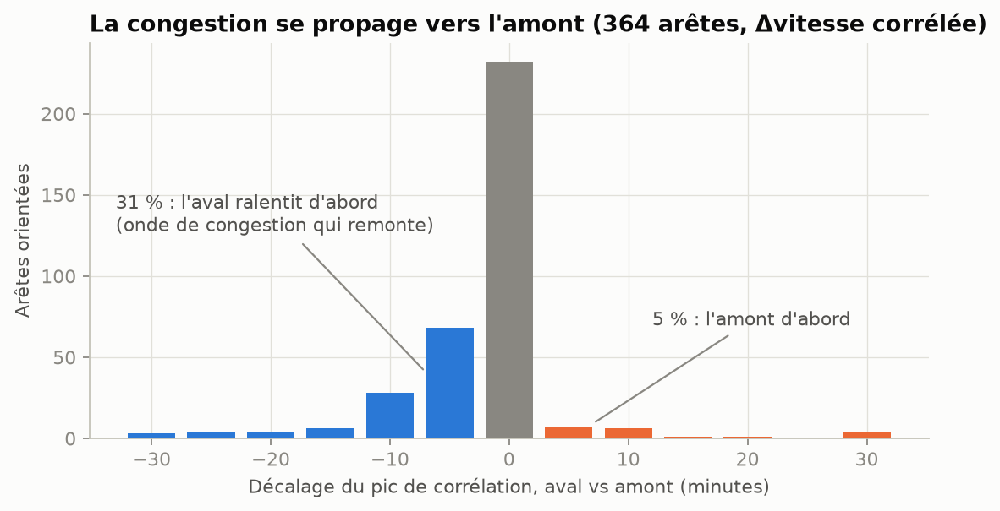

::: {.kpi-row}
::: {.kpi}
[207]{.v}
[capteurs de boucle (autoroutes de LA)]{.l}
:::
::: {.kpi}
[34 272]{.v}
[pas de 5 min (1er mars → 27 juin 2012)]{.l}
:::
::: {.kpi}
[8,1 %]{.v}
[de valeurs manquantes (zéros)]{.l}
:::
::: {.kpi}
[1 722]{.v}
[arêtes pondérées dans l'adjacence]{.l}
:::
:::

Source : dépôt DCRNN. Le `metr-la.h5` est téléchargé depuis le Google Drive référencé par
le README, et `adj_mx.pkl` depuis `data/sensor_graph/`. Commande : `./scripts/download_data.sh`.

::: {.callout-note}
## Format
Le HDF5 a été écrit par pandas en 2019. Les versions récentes de pandas ne le relisent
plus (`TypeError: a bytes-like object is required`). On lit donc directement les blocs
avec `h5py` (`stforecast.data.load_metr_la`). C'est consigné dans le [journal](../journal.qmd).
:::

## Le réseau

{#fig-map}

## La dynamique

{#fig-heat}

{#fig-profile}

Deux constats motivent directement les **identités temporelles** de STID :

1. la vitesse dépend fortement de l'**heure** : deux pointes en semaine, vers 7-9 h et 15-19 h ;
2. le **week-end** a un profil différent, sans pointe du matin.

Un modèle qui ne voit que la fenêtre d'une heure doit *deviner* où il se trouve dans
ce cycle. STID le lui donne.

## Les trous

{#fig-missing}

Conséquences pour le protocole ([détails](protocole.qmd)) :

- les zéros sont **exclus** de la perte et des métriques (masquage) ;
- les modèles reçoivent pourtant des zéros **en entrée**, comme en production ;
- en déploiement, un capteur muet doit être signalé, pas prédit à 0 (voir [System design](../system-design.qmd)).

## Propagation spatiale

{#fig-prop}

Analyse détaillée sur [Le graphe est une hypothèse](../concepts/graphe-hypothese.qmd).
Le notebook [Exploration](exploration.ipynb) reproduit ces analyses pas à pas.
