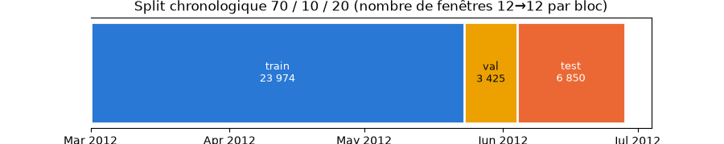

## La tâche

**12 → 12** : une heure d'historique (12 pas de 5 min) pour prévoir l'heure suivante.
On rapporte les erreurs aux pas 3, 6 et 12, soit **15, 30 et 60 minutes**, plus la
moyenne sur les 12 pas.

{#fig-split}

## Choix qui comptent (et pourquoi)

| Choix | Valeur | Raison |
|---|---|---|
| Split | chronologique 70 / 10 / 20 sur les fenêtres | standard DCRNN ; pas de fuite du futur |
| Normalisation | z-score scalaire ajusté **sur le train seulement** | évite de lire les statistiques du test |
| Valeurs manquantes | zéros **masqués** dans la perte et les métriques | un 0 est une panne, pas une vitesse |
| Perte | MAE masquée, calculée sur les vitesses dénormalisées | aligne l'optimisation sur la métrique rapportée |
| Sélection | meilleure MAE de **validation** ; test lu une fois | pas d'optimisation implicite sur le test |
| Seeds | 1 (budget) | limite assumée, discutée dans les [résultats](resultats.qmd) |

## Métriques masquées

$$
\text{MAE} = \frac{\sum_{i} m_i\,|\hat y_i - y_i|}{\sum_i m_i},\qquad
\text{RMSE} = \sqrt{\frac{\sum_i m_i\,(\hat y_i - y_i)^2}{\sum_i m_i}},\qquad
\text{MAPE} = \frac{100}{\sum_i m_i}\sum_i m_i \frac{|\hat y_i - y_i|}{|y_i|}
$$

avec $m_i = \mathbb{1}[y_i \neq 0]$. Implémentation : `stforecast.metrics`, testée dans
`tests/test_metrics.py`. Le test `test_masked_mae_ignores_zeros` vérifie qu'une prédiction
de 999 sur un trou ne compte pas.

## Hyperparamètres

| | STID (BasicTS) | Graph WaveNet (article) |
|---|---|---|
| Entrée | vitesse, heure, jour (C = 3) | vitesse, heure (C = 2) |
| Batch | 32 | 64 |
| Optimiseur | Adam, lr 2e-3, wd 1e-4 | Adam, lr 1e-3, wd 1e-4 |
| Planning | MultiStep [1, 50, 80] × 0,5 | constant, clip 5 |
| Époques | 100 max, patience 30 | 100 max, patience 30 |
| Dropout | 0,15 | 0,3 |

: Hyperparamètres repris des configurations de référence, sans recherche supplémentaire (`configs/*.yaml`). {#tbl-hp}

## Plan d'expérience

```{mermaid}
flowchart LR
  subgraph S["Sans apprentissage"]
    HA["Moyenne historique<br/>(créneau × capteur)"]
    LV["Persistance"]
  end
  subgraph NG["Sans graphe"]
    STID["STID"]
    A1["− id. spatiale"]
    A2["− id. temporelles"]
    A3["− toutes (MLP nu)"]
  end
  subgraph G["Graph WaveNet"]
    G0["route + adaptative"]
    G1["route seule"]
    G2["adaptative seule"]
    G3["sans graphe (TCN)"]
  end
  S --> NG --> G
```
