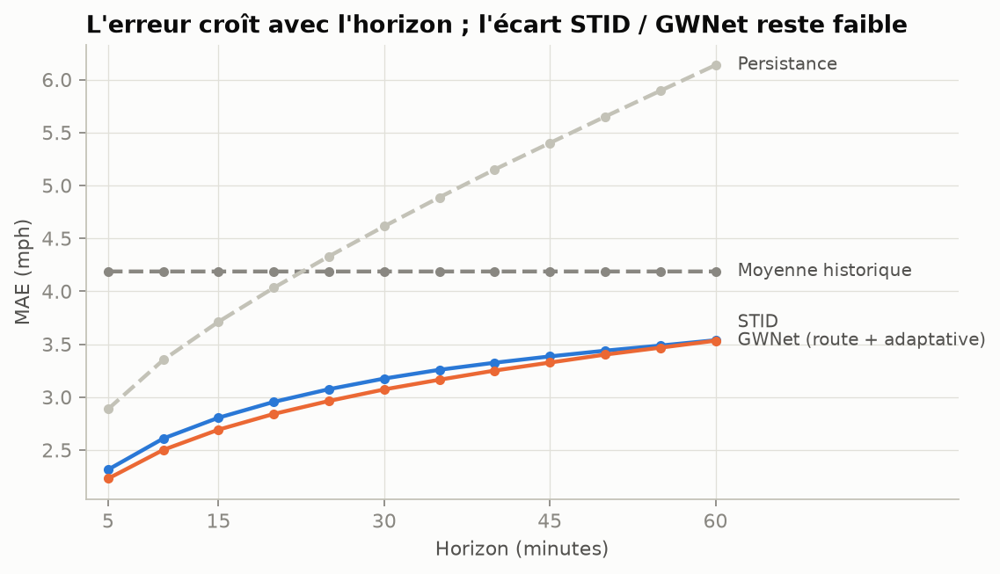
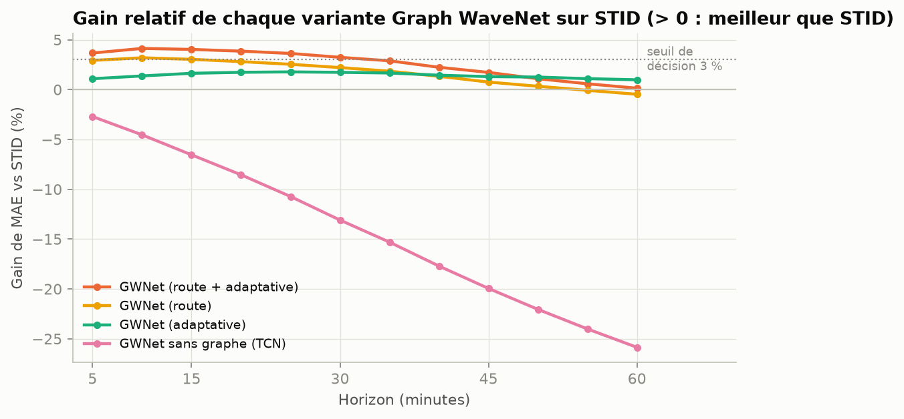
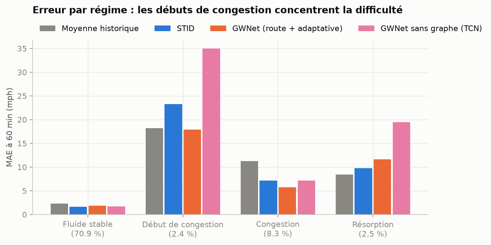

::: {.callout-important}
## Verdict (critère fixé avant les résultats dans `SPEC.md`)
**Non, au sens du critère pré-enregistré.** Graph WaveNet bat STID de **0,1 %** de MAE à
60 min, loin du seuil de 3 %, pour un coût d'entraînement 10 fois plus élevé et une
latence en batch 119 fois plus élevée. **La recommandation par défaut est STID.**

**Mais le graphe n'est pas inutile.** Son gain est réel aux horizons courts (−4 % de MAE à
15 min) et surtout **en congestion** : −23 % d'erreur sur les débuts de bouchon, −11 % de
MAPE à 60 min. La MAE moyenne le masque, car 71 % du test est du trafic fluide.
:::

## Le tableau principal



Les deux implémentations reproduisent la littérature. STID donne 2,80 / 3,17 / 3,54, contre
≈ 2,82 / 3,19 / 3,55 dans BasicTS. Graph WaveNet donne **2,69 / 3,07 / 3,53**, exactement
les chiffres de l'article original sur METR-LA. Les comparaisons qui suivent portent donc
sur des modèles bien entraînés, pas sur des versions affaiblies.

| Écart GWNet vs STID | 15 min | 30 min | 60 min |
|---|---|---|---|
| MAE | −4,0 % | −3,2 % | **−0,1 %** |
| RMSE | −7,9 % | −7,1 % | −3,7 % |
| MAPE | −9,8 % | −11,1 % | **−10,8 %** |

: Gain relatif de Graph WaveNet (négatif = moins d'erreur). Calculé depuis `results/*/metrics.json`. {#tbl-gain}

**Pourquoi les métriques divergent.** La MAE pèse chaque mph d'erreur pareil. Le RMSE pénalise
les grosses erreurs. Le MAPE divise par la vitesse réelle, donc **amplifie les erreurs à
basse vitesse, c'est-à-dire en congestion**. Un gain de MAPE de 11 % avec une MAE inchangée
signifie que Graph WaveNet se trompe moins quand ça bouchonne, et un peu plus quand ça roule.

## Par horizon

{#fig-horizon}

{#fig-gain}

Le graphe aide **à court terme** : à 15 minutes, l'état des voisins est l'information la plus
fraîche sur ce qui arrive. À 60 minutes, l'onde de congestion a eu le temps de traverser
plusieurs capteurs, et la mémoire statistique (identités) rattrape le contexte spatial.

## Par régime de trafic



{#fig-regimes}

C'est le résultat le plus utile pour un décideur :

- **Début de congestion** (2,4 % du test) : STID se trompe de 23 mph en moyenne, *plus que
  la moyenne historique* (18 mph). Il prédit que la route reste fluide. Graph WaveNet descend
  à 17,9 mph, car il voit l'aval ralentir.
- **Congestion installée** (8,3 %) : Graph WaveNet fait −20 % d'erreur (5,8 contre 7,2 mph).
- **Trafic fluide** (71 %) et **résorption** : STID est meilleur. Graph WaveNet anticipe des
  ralentissements qui n'arrivent pas, ou tarde à voir la reprise.

::: {.callout-tip}
## Lecture métier
Pour un service de dispatch, une erreur de 20 mph au début d'un bouchon coûte beaucoup plus
cher qu'une erreur de 0,2 mph sur une autoroute fluide : c'est un retard de livraison contre
rien. **Si la fonction de coût métier est pondérée vers la congestion, le graphe gagne son
pari.** Si elle est uniforme, il le perd. Le critère du SPEC (MAE moyenne) ne le voyait pas.
C'est la leçon principale du projet (voir le verdict).
:::
