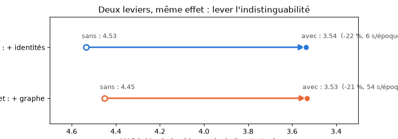

::: {.lead-question}
Un STGNN suppose que la congestion se propage le long du réseau, et que cette structure
porte du signal. Mais **le graphe est une hypothèse, pas une donnée**. Avant de payer son
coût, il faut montrer qu'il bat un baseline *non-graphe* bien conçu.
:::

## La réponse courte

::: {.kpi-row}
::: {.kpi}
[3,54 vs 3,53]{.v}
[MAE à 60 min (mph), STID vs Graph WaveNet]{.l}
:::
::: {.kpi}
[−4 %]{.v}
[erreur à 15 min avec le graphe]{.l}
:::
::: {.kpi}
[−23 %]{.v}
[erreur en début de congestion avec le graphe]{.l}
:::
::: {.kpi}
[× 10 / × 119]{.v}
[coût d'entraînement / latence batch du graphe]{.l}
:::
:::

**Au sens du critère fixé à l'avance, le graphe ne gagne pas son pari** sur METR-LA : même
précision moyenne à 60 min, pour un coût d'un ordre de grandeur supérieur. **STID est la
recommandation par défaut.** Le graphe apporte pourtant un gain réel là où le dispatch en a le
plus besoin, à court terme et au début des bouchons. Il redevient compétitif si la métrique
métier pondère ces situations. [→ Résultats détaillés](experience/resultats.qmd)

{#fig-hero}

## Parcourir le site

| | Page | Pourquoi la lire |
|---|---|---|
| 🔭 | [Modèles de fondation ST](veille/foundation-models.qmd) | où va le domaine : survey STFM et UrbanFM (2026) |
| 🔭 | [STID](veille/stid.qmd) | le baseline anti-hype, et ce qu'il dit des STGNN |
| 📖 | [Lecture : DCRNN](veille/dcrnn.qmd) | le papier fondateur, ce qui a vieilli, ce qui reste |
| 💡 | [Le graphe est une hypothèse](concepts/graphe-hypothese.qmd) | d'où vient l'adjacence, et comment la valider |
| 💡 | [L'indistinguabilité](concepts/indistinguabilite.qmd) | pourquoi un embedding d'identité vaut presque un graphe |
| 💡 | [Diffusion](concepts/diffusion.qmd) · [Architectures](concepts/architectures.qmd) | les mécanismes, en équations et en code |
| 🧪 | [Données](experience/donnees.qmd) · [Notebook](experience/exploration.ipynb) | METR-LA : réseau, dynamique, trous, propagation |
| 🧪 | [Protocole](experience/protocole.qmd) | fixé avant les résultats |
| 📊 | [Résultats](experience/resultats.qmd) · [Ablations](experience/ablations.qmd) · [Coûts](experience/couts.qmd) | le verdict, et d'où il vient |
| 🏗️ | [System design](system-design.qmd) | prévision ST pour un réseau logistique |
| 🗒️ | [Journal](journal.qmd) | déroulé daté du projet |

## Les trois idées à retenir

1. **Toujours entraîner STID d'abord.** Il atteint en 8 minutes le niveau d'un STGNN
   entraîné 80 minutes. C'est la barre que tout modèle à graphe doit franchir.
2. **Le graphe et les identités sont substituables en moyenne**, mais pas dans les
   situations rares. Mesurer par régime (fluide, début de congestion, congestion, résorption),
   pas seulement en moyenne.
3. **Fixer la métrique avant les résultats ne suffit pas : il faut fixer la *bonne*.**
   La métrique de décision doit venir du coût métier (retard de livraison), pas de l'habitude
   du benchmark.
