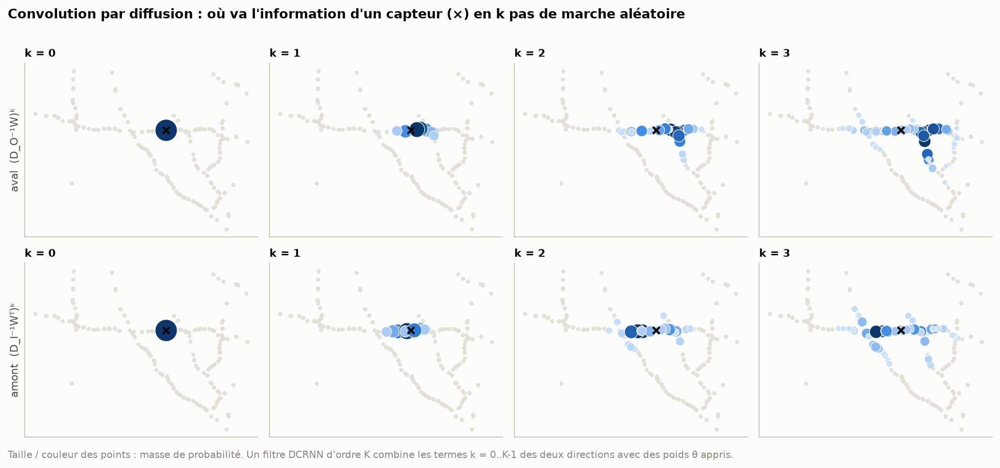

[arxiv.org/abs/1707.01926](https://arxiv.org/abs/1707.01926) · code et données : [github.com/liyaguang/DCRNN](https://github.com/liyaguang/DCRNN)

::: {.callout-note}
## Pourquoi ce papier
C'est le texte fondateur du domaine **et** celui de nos données : METR-LA, l'adjacence
`adj_mx.pkl` et le protocole 70/10/20 avec métriques masquées viennent de ce dépôt.
Tous les STGNN ultérieurs s'y comparent.
:::

## 1. Le problème posé

Prévoir le trafic est difficile pour trois raisons :

1. **dépendance spatiale complexe** sur un réseau routier **orienté** : ce qui se passe en
   aval n'affecte pas l'amont de la même façon ;
2. **dynamique temporelle non linéaire** (pointes, incidents) ;
3. **horizons longs**, où les erreurs s'accumulent.

## 2. L'idée-clé : le trafic comme diffusion sur graphe

Le flux de véhicules est modélisé comme un **processus de diffusion** sur le graphe
des capteurs, c'est-à-dire des marches aléatoires. Le noyau de convolution par diffusion
combine des marches **avant** et **arrière** :

$$
X_{:,p} \star_{\mathcal{G}} f_\theta \;=\; \sum_{k=0}^{K-1}
\Big( \theta_{k,1}\,\big(D_O^{-1} W\big)^{k} \;+\; \theta_{k,2}\,\big(D_I^{-1} W^{\top}\big)^{k} \Big) X_{:,p}
$$

- $W$ : adjacence pondérée. Dans le dépôt, c'est un **noyau gaussien seuillé sur les
  distances routières**, $W_{ij} = \exp(-d_{ij}^2/\sigma^2)$ si au-dessus d'un seuil (0,1).
- $D_O^{-1}W$ : matrice de transition **aval** ; $D_I^{-1}W^\top$ : **amont**.
- $K$ : nombre de pas de diffusion, donc la taille du voisinage vu par le filtre.
- Coût $\mathcal{O}(K|\mathcal{E}|)$ grâce à la parcimonie du graphe.

{#fig-diff}

Pourquoi deux directions ? Notre [exploration](../experience/donnees.qmd) le montre : les
**ondes de congestion remontent le flux**. L'aval ralentit avant l'amont sur près d'un
tiers des arêtes orientées. Un filtre à une seule direction raterait ce signal.
