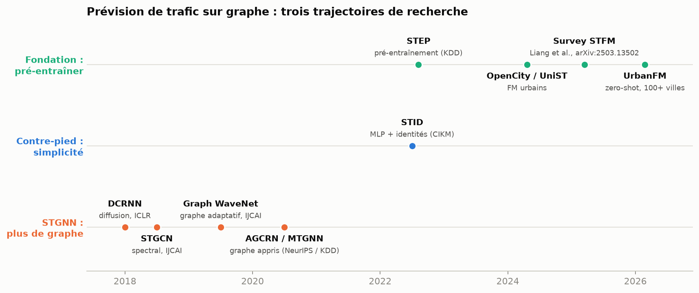

::: {.callout-note}
## En une phrase
La recherche quitte le « un STGNN par jeu de données » pour des **modèles pré-entraînés
sur des centaines de villes** et transférés à un réseau inconnu. Pour un réseau logistique
qui ajoute des hubs chaque trimestre, c'est la promesse qui compte. Elle reste à
valider sur *son* réseau.
:::

{#fig-timeline}
